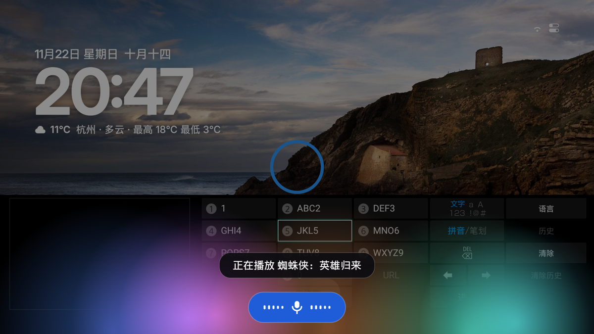
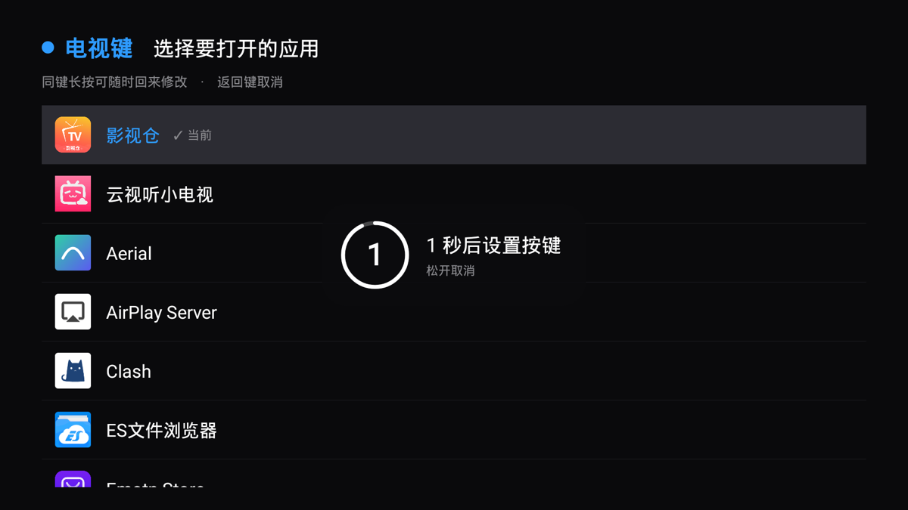
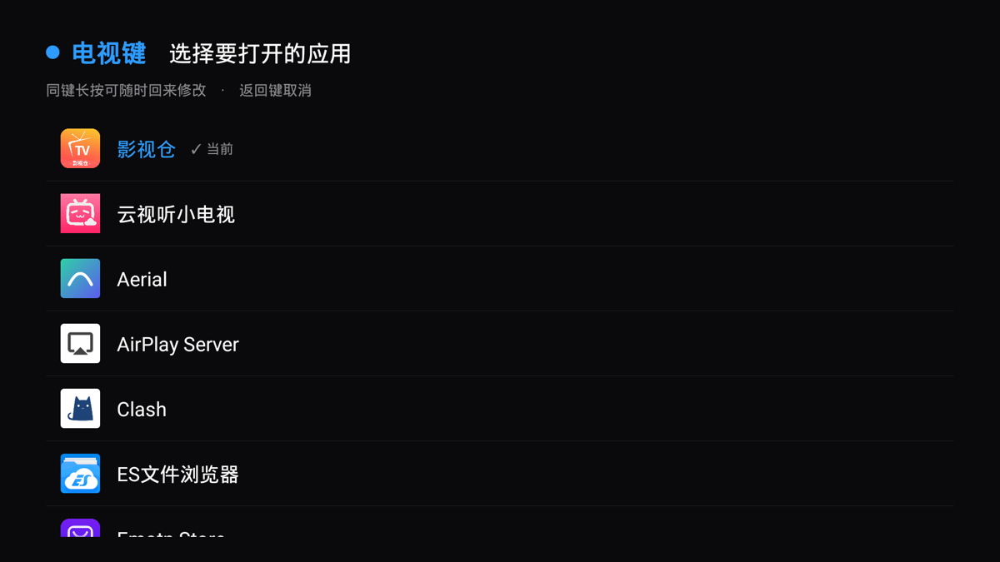
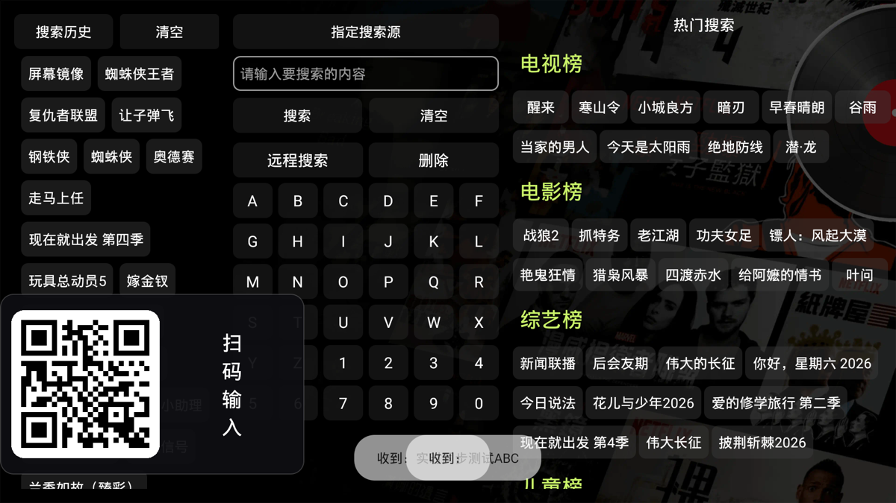
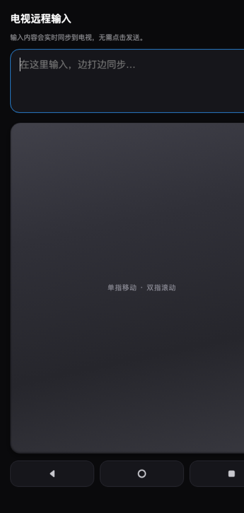
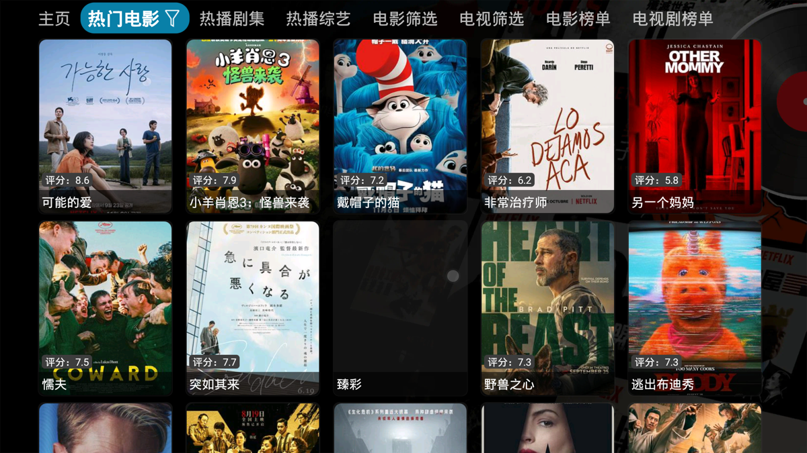

# Sony BRAVIA 遥控器增强助手

把一台普通的索尼 Android TV，改造成「语音助手 + 自定义按键 + 手机当遥控」的中控。

> 本项目基于一台实机开发与验证：**Sony BRAVIA XR-65X90J（代号 BRAVIA_VH2，Android 10）**
> 所有按键码、系统限制、踩坑记录均来自真机测试，非理论推导。

---

## 一、适配型号

### 已验证机型

| 项目 | 值 |
|---|---|
| 商品型号 | Sony BRAVIA XR-65X90J |
| 系统内部代号 | `BRAVIA_VH2` / `BRAVIA_VH2_M_CN`（国行） |
| 芯片平台代号 | `Valhalla_CHD` |
| 代际标记 | `SONYANDROIDTV2021M5`（2021 年 M5 平台） |
| 系统版本 | Android 10（SDK 29） |
| 屏幕分辨率 | 1920 × 1080 |
| 遥控器 | 索尼原装蓝牙语音遥控（含语音键 / 屏显键） |

### 硬件规格速查

| 项 | 参数 |
|---|---|
| 屏幕 | 65 英寸 4K（3840×2160），全阵列 LED |
| 整机尺寸（无底座） | 1452 × 834 × 72 mm |
| 重量（无底座） | 22.9 kg |
| VESA | 300 × 300 mm |
| HDMI | 4 路（1 路 eARC） |
| 无线 | Wi-Fi 双频 + 蓝牙 4.2 + Chromecast + AirPlay 硬件支持 |

> 关键细节：**系统 UI 层运行在 1080p**（不是 4K），所有坐标计算按 1920×1080。

完整规格与遥控器布局见 [docs/HARDWARE.md](docs/HARDWARE.md)。

### 理论兼容范围

**基本可用**（需微调按键码）：

- Sony BRAVIA 2019–2023 年 Android TV 机型（X8000G ~ X95L 系列）
- 同代 MediaTek M5 / M6 平台机型
- 其他品牌 Android TV 9+（键码可能不同，需自行抓取）

**大概率不适用**：

- 2024 年后改用 Google TV 新遥控的机型（键码体系变化）
- 非 Android 系统的索尼电视（Linux 老系统）

### 兼容性判断方法

在电视上执行以下命令，能读出 `BRAVIA_VH2` 或 `SONYANDROIDTV2021` 即高度兼容：

```bash
adb shell getprop ro.product.device
adb shell getprop ro.vendor.nrdp.modelgroup
```

---

## 核心功能

### 一、让索尼原厂桌面焕然一新

索尼原生桌面（Aerial / Google TV）信息密度低、入口割裂——想看的内容要一层层翻，常用的应用散落在长列表里，遥控器方向键按到手酸。

改造后的实际体验：

| 改造前 | 改造后 |
|---|---|
| 翻列表找影视仓，按 3-5 次方向键 | 按一下电视键，秒开 |
| 想搜片子要切到搜索页，逐字按遥控器 | 长按语音键说片名，直接出结果 |
| 输入文字用方向键选字母，打一个词要十几秒 | 按屏显键扫码，手机上打字，实时同步 |
| 遥控器不在手边就干瞪眼 | 手机扫码后当触控板用 |

桌面本身不动（保留原厂质感），**改变的是“到内容”的路径长度**：原来 5 步，现在 1-2 步。

### 二、自定义 4 个空闲按键

索尼遥控器上有 4 个键，日常几乎用不到——原生功能对国内用户价值很低：

| 按键 | 原生功能 | 为什么用不到 |
|---|---|---|
| **电视** | 切到天线/有线电视频道 | 国内没人看有线电视 |
| **视频** | 切到视频输入源 | 有 HDMI-CEC 自动切换 |
| **屏显** | 显示信号格式信息 | 只在调试时有用 |
| **主页长按** | 无 | 系统没定义长按行为 |

这 4 个“闲置资产”被重新分配：

```
电视键     →  影视仓（可改绑任意应用）
视频键     →  云视听小电视（可改绑任意应用）
主页长按   →  一键清理后台（带彩带奖励动画）
屏显键     →  二维码扫码输入面板开关
```

**改绑方式**：长按对应键 2 秒，出现圆圈倒计时，走完弹出应用列表，选中即生效。不用进设置、不用装额外工具。

### 三、语音搜索全面升级

原生语音搜索的局限：

- 只能搜影视内容，说“打开设置”它不懂
- 识别完必须手动确认，不能直接执行
- 中文识别率一般，长句容易断

改造后的语音能力：

| 能力 | 说明 |
|---|---|
| **通用转写** | 说什么转什么，不做内容类型限制 |
| **指令执行** | 打开应用 / 调音量 / 首页返回 / 影视搜索 / 卸载应用 |
| **智能分流** | 有输入框时自动填入文字，没输入框时才当指令 |
| **边说边出字** | 识别过程实时显示在胶囊里，不用等说完 |
| **松手即执行** | 已有文本立刻匹配指令，不等最终结果 |

一句「我想看流浪地球」，自动打开影视仓并搜索——中间不需要任何点击。

---

## 三个真实使用场景

### 场景一：晚上想看电影

```
旧流程：
拿起遥控器 → 主页 → 方向键翻 4 次找到影视仓 → OK
→ 方向键移到搜索 → OK → 方向键选 12 个字母 → OK

新流程：
长按语音键 → 说「我想看流浪地球」→ 松手
（约 2 秒后，影视仓已经打开并显示搜索结果）
```

### 场景二：搜索框要输入中文

```
旧流程：
方向键选拼音首字母 → 翻页找字 → 一个个确认（输入"繁花"约 20 秒）

新流程：
按屏显键 → 电视左下角出现二维码 → 手机扫一下 → 打开网页
→ 手机上正常打字（输入法随便用）→ 电视输入框实时同步
→ 打完不用点发送
```

### 场景三：遥控器找不到 / 躺在沙发上不想动

```
手机扫码打开网页 → 触摸板区域单指滑动 → 电视上光标跟着走
→ 轻点选中 → 双指上下滑翻页 → 底部三个键做返回/主页/多任务
```

---

## 文档索引

| 文档 | 内容 |
|---|---|
| [docs/HARDWARE.md](docs/HARDWARE.md) | 电视完整规格、遥控器外形与按键布局、键码对照 |
| [docs/FEATURES.md](docs/FEATURES.md) | 每个按键的详细行为、手机端全部手势 |
| [docs/REQUIREMENTS.md](docs/REQUIREMENTS.md) | 45 条需求演进记录（含踩坑顺序） |
| [docs/PROMPT.md](docs/PROMPT.md) | 复刻这个项目的提示词 + 环境坑排查 |
| [docs/AIRPLAY.md](docs/AIRPLAY.md) | AirPlay 投屏方案、部署步骤、踩坑 |

---

## 二、功能清单

详见 [docs/FEATURES.md](docs/FEATURES.md)，摘要如下：

| 模块 | 能力 |
|---|---|
| **语音助手** | 长按语音键说话 → Siri 风格 HUD → 语音识别 → 执行指令或填入输入框 |
| **自定义按键** | 电视键 / 视频键短按打开指定应用，长按 2 秒弹出应用选择器 |
| **一键加速** | 长按主页键清理后台，完成时洒下彩带特效 |
| **扫码输入** | 按屏显键弹出二维码，手机扫码后在网页里打字，实时同步到电视输入框 |
| **手机遥控** | 手机网页提供触摸板：单指移动指针、轻点单击、长按、双指滚动、三大导航键 |
| **AirPlay 投屏** | 装 android-airplay-server，iOS/Mac 可直接投屏（需 root，见 [AIRPLAY.md](docs/AIRPLAY.md)） |

---

## 三、按键映射表

这是本项目的核心——**在你那支遥控器上，每个键被改成了什么**。

| 按键 | 原始键码 | 点按行为 | 长按行为 |
|---|---|---|---|
| **语音键** | `KEYCODE_SEARCH` (84) | 短按无动作 | **按住说话**，松手识别 |
| **电视键** | `KEYCODE_TV` (170) | 打开绑定应用（默认影视仓） | **2 秒倒计时** → 应用选择器 |
| **视频键** | `KEYCODE_VIDEO` (203) | 打开绑定应用（默认云视听小电视） | **2 秒倒计时** → 应用选择器 |
| **屏显键** | `KEYCODE_INFO` (165) | 切换二维码面板显示/隐藏 | 同点按（不拦截原生时间插件） |
| **主页键** | `KEYCODE_HOME` (3) | 系统默认回主页 | **2 秒** → 清理后台 + 彩带 |
| **返回键** | `KEYCODE_BACK` (4) | 系统默认 | 系统默认 |

### 各状态界面样式

**① 语音识别 HUD**（长按语音键）



底部流体光晕 + 白色文字胶囊 + 蓝色麦克风胶囊，左右各 7 根声波柱。

**② 长按倒计时**（长按电视/视频/主页键）



屏幕中央蓝色进度环，1~2 秒转满后执行长按动作。

**③ 应用选择器**（长按电视键满 2 秒）



列出所有已安装应用，当前绑定项带 ✓ 标记。选中后立即生效，下次短按即打开该应用。

**④ 二维码扫码面板**（按屏显键）



左下角浮窗，左侧二维码、右侧竖排「扫码输入」，与原生时间插件同步出现/消失。

**⑤ 手机端远程输入页**（扫码后打开）



上方输入框（实时同步），中间触摸板，底部三大导航键。

**⑥ 手机控制的光标**（单指滑动触摸板）



电视上出现的白色圆形指针，1 秒无操作自动淡出。

---

## 四、使用说明

### 语音助手

```
长按语音键 ──▶ 说「打开影视仓」 ──▶ 松手 ──▶ 应用启动
长按语音键 ──▶ 说「音量调到 30」 ──▶ 松手 ──▶ 音量变化
长按语音键 ──▶ 说「蜘蛛侠」 ──▶ 松手 ──▶ 搜索影视
```

支持的指令类型：

- **应用**：打开 XX / 启动 XX
- **音量**：调到 N / 加 / 减 / 静音 / 取消静音
- **导航**：主页 / 返回 / 最近任务 / 通知 / 设置
- **搜索**：我想看 XX / 搜索 XX / 找一下 XX
- **投屏**：打开屏幕镜像 / 打开隔空播放
- **卸载**：卸载 XX

在有输入框的界面，识别结果会**直接填入输入框**而不是当指令执行。

### 自定义按键

```
短按电视键 ──▶ 立刻打开影视仓
长按电视键 2 秒 ──▶ 倒计时 → 应用列表 → 选新应用 → 下次短按生效
```

已在前台时按对应键不会重复启动（避免闪屏）。

### 扫码输入

```
按屏显键 ──▶ 左下角出现二维码
手机扫码 ──▶ 打开网页
网页输入 ──▶ 电视输入框实时同步（无需点发送）
再按屏显键 ──▶ 面板收起
```

### 手机遥控

| 手势 | 电视端效果 |
|---|---|
| 单指滑动 | 光标跟随移动 |
| 单指轻点 | 在光标位置单击 |
| 单指长按 | 在光标位置长按 |
| 双指上下滑 | 页面滚动（距离等比换算） |
| 底部 ◀ | 返回 |
| 底部 ○ | 主页 |
| 底部 ■ | 多任务 |

---

## 五、技术实现要点

| 能力 | 实现方式 |
|---|---|
| 按键拦截 | `AccessibilityService.onKeyEvent` + `flagRequestFilterKeyEvents` |
| 语音识别 | `SpeechRecognizer` 调用索尼私有 `VoiceRecognitionService` |
| 文字填入 | `AccessibilityNodeInfo.ACTION_SET_TEXT` |
| 光标移动/点击 | 全屏 `TYPE_APPLICATION_OVERLAY` + `dispatchGesture` |
| 手机通信 | 内置 `ServerSocket` HTTP 服务（端口 8080） |
| 二维码 | zxing-core 本地生成 Bitmap |
| 滚动 | `dispatchGesture` 模拟滑动，距离按屏幕高度换算 |

### 关键配置（缺一不可）

```xml
<!-- res/xml/accessibility_service_config.xml -->
android:canRequestFilterKeyEvents="true"   <!-- 拦截遥控器按键 -->
android:canPerformGestures="true"          <!-- 模拟点击/滑动 -->
android:canRetrieveWindowContent="true"    <!-- 读取界面结构 -->
android:accessibilityEventTypes="typeWindowStateChanged|typeViewFocused|typeViewClicked|typeWindowContentChanged"
```

---

## 六、已知限制与踩坑

| 问题 | 说明 | 应对 |
|---|---|---|
| **应用网络被限制** | 卸载重装后 standby bucket 会掉到 `5 (RESTRICTED)`，socket 全部 `EPERM` | 卸载重装可重置为 `50 (EXEMPTED)`；重启电视也可能恢复 |
| **重装丢录音权限** | `RECORD_AUDIO` 被清除，语音引擎报 `code=9` | `adb shell pm grant` 重新授权 |
| **TV 键被系统抢占** | `KEYCODE_TV` 会被 TV Input 框架优先消费 | 无障碍服务能收到按键，但需要 `return true` 才能完全接管 |
| **影视仓用自定义键盘** | 不走系统输入法，`TYPE_INPUT_METHOD` 检测不到 | 改判「界面存在『请输入』提示」 |
| **指针/点击需要悬浮窗权限** | `SYSTEM_ALERT_WINDOW` 被重置后浮窗全部失败 | `appops set ... SYSTEM_ALERT_WINDOW allow` |

---

## 七、安装部署

```bash
# 1. 编译（需要 JDK 17 + android.jar）
cd keyprobe && ./build.sh

# 2. 安装
adb install -r out/keyprobe.apk

# 3. 授权（三项都必须）
adb shell pm grant com.wb.keyprobe android.permission.RECORD_AUDIO
adb shell appops set com.wb.keyprobe SYSTEM_ALERT_WINDOW allow

# 4. 启用无障碍服务
adb shell settings put secure enabled_accessibility_services \
  com.wb.keyprobe/com.wb.keyprobe.KeyService
adb shell settings put secure accessibility_enabled 1
```

---

## 八、回归测试

项目自带端到端测试脚本：

```bash
cd keyprobe && ./e2e.sh
```

覆盖 22 项检查：基础环境、语音流程、极端连击、二维码浮窗、手机接口、稳定性。

---

## 许可

个人自用项目，仅供参考。修改系统按键行为有风险，请确认能接受后果后再操作。
